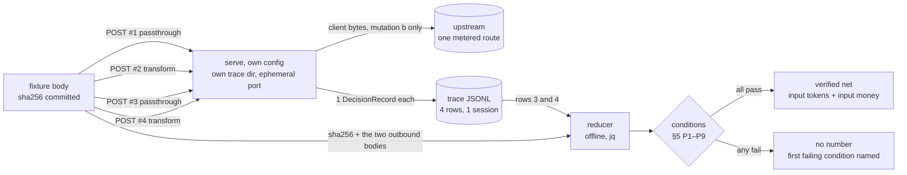

# ADR-059 — the paired control: one body, two modes, four requests — the instrument that can mint the first `verified` saving, and the conditions under which it must print none

- Status: accepted (2026-10-18), **text only**. It decides a measurement method, the fields that carry it and the
  home of its artefacts. It mints **no number** (none appears below; the two arithmetic forms are symbols, and the
  one fully written example is marked *invented*), writes **no product byte**, allocates **no `CONF` id**, and
  moves **no gate, threshold, corpus or L1 envelope** (AGENTS constraint 9 / ADR-012). The run that applies it is
  the next card; its artefacts are what this ADR binds.
- Kind: **an instrument definition for a figure whose definition already exists** — `verified` was ruled by
  `docs/spec.md` §7 and `ADR-058`, and this ADR may not redefine it (the closing paragraph of §2 quotes the
  boundary). It is the
  same shape of artefact as `ADR-030` (the latency method) and `ADR-045` (the fidelity instrument): a method, a
  declared stimulus, a null baseline, and a refusal list — never a threshold.
- Authority: the owner's card of 2026-10-18 (*"C1 — design the paired measurement that can mint the first
  `verified` number"*), which names the gap, the six questions and one acceptance test: a second reader must be
  able to reproduce the number **without trusting the author**.
- Amends: `design/DESIGN.md` **§9** (one pointer sentence at the replay's home), **§12.9** (a dated register
  line) and **§12.25** (new — the method's product-side home, in the form §12.16/§12.17/§12.18 already use);
  `docs/spec.md` **§9.3** (a paragraph naming the reachable route until `vadis replay` lands). No sentence of a
  contract is rewritten.
- Related: `AGENTS.md` constraints **1** (the byte boundary), **2** (content determinism), **3** (the observation
  boundary), **4** (no unverified savings), **5** (no fabricated prices), **7** (English only), **8** (docs before
  code), **9** (the measurement is not part of the search space); **ADR-019** §3/§4/§5 (the transform mode, I1–I3,
  and `net = saved − added`); **ADR-031** background, **D1** (the money arithmetic), **D3** (the window rule),
  **D4** (the label rule, the stricter half), **D5** (a row's provenance); **ADR-032** **D1** (the lever and its two
  figures), **D2** (the triple, and the `+79`-with-zero-edits witness), **D3** (the label ladder's five conditions,
  quoted here and not amended), **D5** (what a `verified` figure may claim); **ADR-045** §2 (the citable-number
  contract) and §3.1 (the null baseline); **ADR-058** §2 (which word names which quantity); **ADR-018** (one amount,
  one currency); **ADR-028** (a harness-only peer; why the product keeps no body); **ADR-009** item 3 (bodies are
  never persisted); **ADR-049** (`key_index`); **ADR-029** (*the method is the loop's, the threshold is not*);
  `docs/spec.md` §2.1, §4.1, §4.6 rule 4, §4.17, §6, §7, §9.2, §9.3; `design/DESIGN.md` §9, §12.12, §12.17,
  §12.18, §12.23; `rules/tool_output.toml` (its four rules, their inline tests and its hard constraint 4);
  `config.example.yaml` §`trace`, §`plugins`, §`plan_policies`.
- Numbering note: `ADR-058` landed with the previous card; this is the next free number in `design/decisions/`.

---

## 1. The gap, in the repository's own words

`ADR-031`'s background states it without softening: **four rounds of measurement and no `verified` cost figure**.
R30 made the live-path byte audits runnable, R31 fixed the recorder and ran the first post-R24 live pair, R32
measured the gateway's own latency under scale, R33 the transform path's latency — and R33's own record says why
none of them produced a token or dollar delta: *"this round measured **latency**, not tokens; the token ledger rows
are `inferred`"*. The last live run's record names the cause in the vocabulary it was written in:
`verified_ineligible_reason: condition-4 instrument-not-usable`. `docs/spec.md` §7 then states the honest reading of
such a run: **with no control turn and no replay, `verified_savings_tokens` is 0**, and that is the report being
correct, not incomplete.

Three things have changed since those four rounds, and all three are preconditions rather than progress:

1. **The lever is reachable.** `vadis wrap` (spec §9.3, ADR-019) supplies `X-Vadis-Transform` through each client's
   own mechanism, so a request can now *ask* for the mode; before it, no shipped client ever did (measured: 0 of
   8,461 records carried a non-empty `transforms[]`).
2. **The vocabulary is closed.** `ADR-058` §2.1 fixed two words with two scopes — `measured` is **one observation**
   and is never a saving; `verified` is **the delta between two worlds** — and §2.2 added the composition rule that
   a difference of two `measured` figures is not `verified` by itself, because the pair has to be *designed*. That
   rule is what makes this ADR necessary rather than optional: a design that added up two adjacent requests would
   now be a named defect, not a shortcut.
3. **The zeros are all in place.** The rule data landed with its 13 inline tests (`rules/tool_output.toml`), the
   ledger writes per-step `edited_paths[]`, and the trace already carries everything the pair needs
   (`usage.*`, `transform_mode`, `transforms[]`, `cost.*`, `config_digest`, `identity.session`). What has never
   existed is a way to make **the second world** appear.

**Why no previous round could mint one, stated structurally.** The client is stateless: it resends the whole
conversation every turn (`store: false`, no `previous_response_id`, a stable `prompt_cache_key`). So the only body
that *is* "the same content" as another is a body controlled **byte for byte**. Two runs of one client produce two
different conversations, and their difference is the conversation. This is not a hypothesis: `ADR-032` §D2 carries
the committed live row — `delta.input_total = +79` with **0 edited path(s)** — as its measured proof that the
between-session route confounds the content change with the treatment, and the third limb of its acceptance triple
(the pair's content difference must be "bounded and published") exists because of that row.

So the missing piece is an **instrument**: a way to make the counterfactual exist, plus a way to say when it does
not.

## 2. The method, in one paragraph

> Take **one request body**, byte for byte, that a shipped rule edits. Send it **four times** to a `serve` of your
> own, changing **only** the `X-Vadis-Transform` header: `passthrough`, `transform`, `passthrough`, `transform`.
> Read the provider's own `usage.input_total` off the **second and fourth** records — the first request of each arm
> exists only to put *that* arm's prefix into the provider's cache and is never measured — and subtract. The
> difference is the transform's input-token delta, `verified`, because the two worlds are one body and one declared
> edit apart. Then refuse to print it unless the nine conditions of §5 hold, and print beside it: the ledger's
> `inferred` decomposition, the cache regime the pair was measured in, the money delta with its window rate, and the
> four `request_id`s that make it checkable.



`verified` here is minted by `docs/spec.md` §7's **first** route — *"a control turn with the transform on/off
within the same session"* — and **not** by the loop ladder's second route. `ADR-032` §D3's five conditions describe
the ladder, which is stricter (condition 0 asks for two distinct observed client session identities, condition 1
for a live external path); a repository-local byte replay meets neither, and §6 below makes the report say so in
the same breath as the figure. That is a scope statement, not a relabel: `ADR-058` §2.1 is untouched, and this ADR
adds no word.

## 3. D1 — the two arms: one body, two modes, four requests, in this order

### 3.1 The unit of content is a body

"Same content" means **byte-identical inbound bodies**. Not "the same conversation": a stateless client resending
the conversation gives two bodies that differ in the tool output, the model's reply and every timestamp, and
`ADR-032` §D2 measured what that does to a delta. Not "the same turn index" either: the four requests of this
design all carry the same body, so their text is identical by construction and no turn-index comparison is needed.

The statelessness that makes two client runs uncomparable is also what makes **one** body sufficient: because the
client resends everything, a single body already *is* the whole conversation up to that point. Nothing has to be
reconstructed across turns, and the pair needs no server-side state.

### 3.2 The four requests, and why the measured pair is the last two

| # | header | role | why it is in the quartet |
|---|---|---|---|
| 1 | `X-Vadis-Transform: passthrough` | **warm-up** (never measured) | the first sight of the *control* prefix: nothing of it is cached yet, so its `input_cached` is a floor and not comparable with anything |
| 2 | `X-Vadis-Transform: transform` | **warm-up** (never measured) | the first sight of the *treatment* prefix; it also stands on the control prefix's shared blocks, so it is the most asymmetric row of the four — the reason it may never be measured |
| 3 | `X-Vadis-Transform: passthrough` | **measured control** | its own arm's prefix is now in the provider's cache to the same degree the treatment arm's will be |
| 4 | `X-Vadis-Transform: transform` | **measured treatment** | same, for the edited prefix |

Three properties of this order, each of which is load-bearing:

- **Warm-up is per arm, not per run.** The two outbound prefixes differ at the edit and are therefore two cache
  entries. `#3` is warm against `#1`'s entry and `#4` against `#2`'s; that symmetry is the whole reason for four
  requests instead of two. With `#1` and `#2` alone the money delta would be **mostly the cache** (a fully cold
  control against a partially warm treatment), which is precisely the class of number this repository keeps
  refusing to print.
- **Alternation, not blocks.** `OFF, OFF, ON, ON` would separate the arms in wall-clock time; the four requests
  must fall inside one cache TTL, one peak/off-peak window and one upstream incident, and the shortest possible
  wall clock across all four is the cheapest way to buy that.
- **The measured pair is fixed as `#3` then `#4`** so that two runs are comparable position by position. The pair's
  *arithmetic* is symmetric (each measured row is warm against its own entry), so the order is a convention for
  readers, not an assumption of the method.

### 3.3 Only the header differs

The four requests carry the same body bytes, the same route, the same model and the same credential. A header is
not a body byte (ADR-019 item 2), so the opt-in cannot perturb the prefix, the block hashes or the two-mutation
table — that is exactly why the mode is a header and not a body field, and it is what makes this pair a *control*
rather than a comparison of two configurations.

The session identity is the body's own `prompt_cache_key`, which is why the fixture is a **responses**-wire body:
the chat wire has no such field (`config.example.yaml`'s `session.key_sources` note says so), and a null session
would make the four records four unrelated observations. On the responses wire all four share one
`identity.session`, which is what lets the report quote the pair as *one control turn within one session* (spec §7)
instead of as two sessions. It is also the wire the owner's own client speaks, so the fixture's shape is the shape
the lever will actually meet.

### 3.4 The instrument runs its own `serve`

Its own config pair, its own `trace.dir`, its own state directory, an **ephemeral** loopback port. Three reasons,
in order of weight: the operator's trace must stay a record of production traffic and not of experiments
(constraint 3's observation boundary, in the direction that matters here — the analysis may read the serving
output, the serving path must never contain the experiment); the pair's provenance needs a `config_digest` that
names *this* experiment; and the price entry it quotes must be the one it actually used (`AGENTS` 5).

**Reversible?** Yes, entirely: no product byte moves, and the quartet shape is a document (this one) plus a fixture.
If the four-request shape proves insufficient — e.g. a provider turns out to write cache only on the first
occurrence and evict aggressively — a sixth request (a second measured pair) is an amendment here and nothing else.

## 4. D2 — the measured quantity, and which record field carries which side

### 4.1 The two figures

| Figure | Computed from | Label |
|---|---|---|
| `net_input_tokens = usage.input_total(#3) − usage.input_total(#4)` | the two measured records, one field each | **`verified`** |
| `net_input_cost = Σ{cost.input_miss, cost.input_hit, cost.cache_write}(#3) − Σ(…)(#4)` | the two records' `cost` groups, pre-peak as the record reports them | **`verified`**, conditional on one currency and one `cost.peak_applied_pct` (§4.4) |

**Why `input_total` and not the tier split.** Cached-ness is a property of the provider's cache at that instant, not
of the bytes; `input_total` is the count of prompt tokens whatever tier served them, so it is a function of the
outbound bytes alone. The *token* delta is therefore cache-regime-independent, which is what lets it be printed from
a pair whose cache states are merely "both warm" rather than "identically warm". The *money* delta is not, and §4.4
and §5.1 R6 handle that difference explicitly instead of hoping it away.

### 4.2 The trace cannot decompose the net, and that is the point

`ADR-019`'s identity is `net = saved − added` over **bytes the rule removed and inserted**. The serving path can
compute the two sides only locally: from payload-text lengths via `estimate_tokens = bytes / 4`
(`crates/vadis-core/src/transform.rs:189-191`), written per step into `transforms[].saved_input_tokens` and
`added_input_tokens` as **`inferred`** (GAP-Q14: the dependency allowlist has no tokenizer). A pair measures the
**net**, and only the net. Four consequences, each a rule:

- The verified figure is a **net**. There is no verified "saved" and no verified "added", and a report that prints
  either one under the `verified` label is claiming the decomposition the trace does not have.
- The ledger's two sides stay `inferred`, are printed **beside** the net as the *prediction*, and are never summed
  with it (ADR-031 D4.3).
- `estimator_error = net − Σ(saved_input_tokens − added_input_tokens)` is a **published diagnostic of the local
  estimator**, not a saving. It is the first measurement of GAP-Q14's error this repository will own — a genuinely
  useful by-product, and the only place two labels may sit in one table as long as neither is added to the other.
- One structural reason the estimate *must* miss — now measured, not assumed. Of the first run's 318-token
  estimator error, **~300 tokens are the estimator's 4-bytes-per-token constant** (the measured pair is 5,199 B
  over 1,599 tokens = **3.25 B/token**, so the constant over-counts the byte savings) and only **~18 tokens are
  JSON escaping**: `edited_paths[].bytes_in` / `bytes_out` are **payload text** lengths, while the tokens the
  upstream counts are over the **JSON-escaped span** — a newline is one character in the payload and two bytes
  in the body, so a rule that removes line breaks — every rule in `rules/tool_output.toml` that drops or joins
  lines — also changes the escaping. The escaping effect is real but second-order; the constant is the dominant
  term. Only the provider's count sees both, which is one more reason the measured pair is not a luxury
  version of the ledger.

### 4.3 Output is outside the pair

The transform edits the request; the two arms therefore ask for two **generations**. `usage.output` and
`usage.reasoning` differ for a reason that has nothing to do with the transform (sampling), and with one generation
per arm there is no control for them. So:

- the verified figure is **input-side only**;
- `cost.output` is **excluded** from `net_input_cost`;
- a report that prints a `cost.total` delta is printing a number that contains an unpaired generation, whatever
  else it says;
- if the transform ever *does* shorten answers, that is a real effect — and a different measurement, with no
  instrument here. It may be reported as a difference of two `measured` output counts, labelled `measured`, and
  never as part of the saving.

### 4.4 Money: one currency, one window, one rounding point

- **`cost.currency` must be equal on both measured rows** (ADR-018: one amount, one currency, no rate anywhere in
  the product; `Money::checked_add` refuses a mixed add). A pair whose routes differ is refused before this point
  (§5 P2).
- **`cost.peak_applied_pct` must be equal** (ADR-031 D3: the rate is decided by each row's own `ts` against the price
  entry's windows, so a pair straddling a boundary compares two different rates). The report prints the value beside
  the figure.
- **The published money figure is the pre-peak tier delta as the record reports it.** The product has exactly one
  rounding point (the `/1000` floor, `crates/vadis-core/src/cost.rs:279-300`, ADR-031 D1) and this instrument adds
  no second one. A reader who wants the run's own-rate delta multiplies by `peak_applied_pct / 100` — an exact
  scaling of a pre-peak difference, which is not a re-rounding.
- **A plan account has no money figure.** An in-plan route's marginal price is 0 (spec §4.6 rule 4): the delta is
  arithmetically zero and morally meaningless. The instrument prints tokens and says why the money line is absent
  (§5 P7 and R4). Zero dollars is not a saving.

### 4.5 One fully worked arithmetic form, **invented**

Every quantity below is a symbol; the one line with numbers in it is invented to show the shape of the report and
must never be quoted as a reading.

```text
T_off = usage.input_total(#3)          T_on = usage.input_total(#4)
net_input_tokens = T_off − T_on                      # verified, input-side only
predicted_net    = Σ(saved_input_tokens − added_input_tokens)   # inferred, from transforms[] of #4
estimator_error  = net_input_tokens − predicted_net  # inferred-vs-verified distance, published

M_off = cost.input_miss + cost.input_hit + cost.cache_write of #3
M_on  = the same sum of #4
net_input_cost = M_off − M_on          # verified, pre-peak, in cost.currency, at cost.peak_applied_pct

invented illustration of the shape only — NOT a measurement, NOT a reading of anything:
  T_off = 12000, T_on = 10000 → net_input_tokens = +2000   (invented numbers)
```

## 5. D3 — the nine conditions, and what fails first

A pair is **admissible** iff all nine hold. Each is a field the trace already carries except P9, which is a second
quartet (D6/§8). The report prints each one with its observed value; an inadmissible pair prints the **first**
failing id and no figure.

| # | Condition | Field / source | Why it exists |
|---|---|---|---|
| **P1** | one process, one revision: all four records carry the same `config_digest` and come from one `serve` | `config_digest` ×4 | two revisions means two price tables, two transform sets or two rosters behind one "pair" |
| **P2** | one route, one model, one credential: `decision.provider`, `decision.model`, `decision.key_index` equal; `result.failover_from` null | decision + result groups | a failover or a second key is a different upstream (different tokenizer, different cache, possibly a different price) |
| **P3** | everything measured: `usage_missing: false`, `result.status` 2xx, no `stream_truncated` entry in `errors[]`, no `cache` group | usage, result, errors, cache | a `cache` group means the response came from the exact-match store (spec §4.17) and **no upstream call was made** — there is no observation; a truncation is a partial body |
| **P4** | the mode is what the header asked: `transform_mode` is `passthrough` on `#1`/`#3` and `transform` on `#2`/`#4` | `transform_mode` | I3's closed-mode limb, observed rather than assumed: a control row that says `transform` is a wiring defect, and closed-mode byte equality is the thing that keeps the control a control |
| **P5** | the treatment fired: `#4` carries ≥ 1 `transforms[]` entry with ≥ 1 `edited_paths[]` | `transforms[]` | ADR-032 D2 limb 1. Under `transform_mode: transform` with an empty `transforms[]` there was **no treatment**; a delta of 0 would then be a false statement about the lever, not a measurement of it |
| **P6** | the edit is local: the two measured rows' `prefix.blocks[]` hashes differ in exactly the block(s) the `edited_paths[]` fall in, and every later block hashes identically | `prefix.blocks[].hash` | the block hash is the serving path's own byte digest; a second differing block is a second edit nobody declared |
| **P7** | metered, one currency, one window: the route's entry is `account: api` (or the key absent), `result.plan_switch` null, `cost.quota_after` null, `cost.currency` equal, `cost.peak_applied_pct` equal | cost, result, config | §4.4 — a plan row books 0 in every tier and records `quota_after` (the trace's own in-plan detector), a displaced row carries a re-prefill event of its own and may land in-plan, and a mixed window has two rates |
| **P8** | one cache regime: both measured rows warm (`input_cached > 0` on both) or both cold (`input_cached == 0` on both) | `usage.input_cached` ×2 | a mixed regime means the money delta is mostly the cache (the two rows are not comparable in price terms), while the token delta survives |
| **P9** | the null control reads zero | §8 | identical bytes must produce identical `usage.input_total`; a non-zero null means the ruler is broken and **no figure at all** may be printed |

The regime names in P8 are **observed, never chosen**. The instrument does not wait out a TTL or warm a cache to
obtain a preferred regime; it prints which regime it got, because the money figure is conditional on it and a
reader must be able to see that.

### 5.1 The refusal table — what may still be printed when a condition fails

The eight refusals are the answer to the card's question *when does the instrument print no number instead of a
small one*. Each names what survives; **nothing is ever printed as 0 to stand for "not measured"** (spec §7: an
absent measurement is not a zero).

| Id | Failing condition | What the report may still say |
|---|---|---|
| **R1** | P1, P2 or P3 — the four rows are not one process / one route / fully measured | **nothing.** There is no pair to reduce; the report prints the rows and the failing field and stops |
| **R2** | P4 or P5 — the control asked for the mode, or the treatment did not fire | **nothing.** With no observed treatment a delta of 0 would be a claim about the lever |
| **R3** | P6 — a second block changed | **nothing.** An undeclared second edit makes the delta unattributable |
| **R4** | P7 on a plan account (`plan_switch` present, `cost.quota_after` present, or the entry's `account: coding_plan`) | **the tokens only**, with the sentence *"marginal price 0 on this account: a money saving cannot be stated"* — never `0` and never a dollar figure (§4.4) |
| **R5** | P7 on currency or window — `cost.currency` or `cost.peak_applied_pct` differ | **the tokens only**, and the two values side by side so the rejection is legible; the money delta would be a cross-currency or cross-rate subtraction, which the product refuses in its own type (ADR-018) |
| **R6** | P8 — mixed cache regime | **the tokens only**, plus the two rows' `input_cached / input_total` ratios and — as a **labelled counterfactual** — the money delta at the other regime's rate (ADR-031 D3: a counterfactual is printed as one, never as the spend) |
| **R7** | P9 — the null control is non-zero | **nothing at all**, including the tokens: the ruler is broken and every figure in the report inherits the defect |
| **R8** | the artefacts disagree with the figure — dirty tree, a fixture or rule-file digest that does not match the report's, a `body_hash` that does not recompute (F3) | **nothing at all**; the report may describe the run, and its `verdict` is `refused` |

R4–R6 are the cases where a partial truth is still worth more than silence: the token delta does not depend on the
price table or on the cache tier, so refusing it because the money is unpriceable would throw away a measurement.
R7–R8 are the opposite: they say the instrument itself is suspect, and a suspect ruler discounts every reading it
took. **No refusal ever substitutes a small number for an absent one** — that is the whole point of the table.

## 6. D4 — provenance: what must be in the report, or the figure is not `verified`

`ADR-031` D4.2 requires "the producing row's provenance and condition list attached (VER-4.4)"; `ADR-045` §2 states
the four clauses that make a figure *citable*. Together they bind six artefacts. Any one absent ⇒ the figure is
`inferred`-graded at best, and the report says which one is missing.

1. **The producing rows.** For each of the four: `identity.request_id`, `ts`, the hourly trace file
   (`YYYY-MM-DDTHH.jsonl`) and the JSONL line number; and from the event log, the `upstream.submitted` row's
   `body_hash` — the sha16 of that attempt's **byte-final outbound** body (post transform and post model
   rewrite), computed by the serving path itself. That digest is the byte anchor: the object the provider
   actually received, named by the process that sent it. The `request.received` row's `body_hash` is a
   different domain — the vadis-visible **inbound** bytes after the vadis-owned-key deletion and before the
   rewrite (DESIGN §12.10.5 R4), which on the transform path are already the transformed bytes — and using it
   as this anchor makes F3 red on a correct build.
2. **The fixture.** The body bytes at a **tracked** path with their sha256 (the full digest, not the 16-hex block
   form), its `source` class (`composed` | `captured-sanitised`), and — optionally and preferably — the two
   outbound bodies `off.out.json` / `on.out.json`, so a stranger can recompute both `body_hash`es without running
   the rule engine. Constructed data only: `rules/tool_output.toml`'s hard constraint 4 forbids real secrets,
   private code and customer data, and a capture that cannot be sanitised may be used privately but may not be
   committed — in which case the number is not reproducible and may not be quoted.
3. **The rule set.** The sha256 of `rules/tool_output.toml` **and** the transform plugin's config entry. The
   effective set `S` is a function of both (ADR-019 I1/I2), so the same body under a different rule file is a
   different experiment with the same name.
4. **The commit and the gates.** `git rev-parse HEAD`, an empty `git status --porcelain` (the same clause
   `ADR-032` D3 condition 4 names, kept because a dirty tree is exactly how an instrument reports on code it was
   not given), the sha256 of the binary that served, and the four gates green at that commit.
5. **The condition list.** P1–P9 with their observed values, printed, each pass or fail — not a summary
   ("conditions met") but the values, so a reader can disagree with the *judgement* rather than only with the
   figure.
6. **The price entry.** The route, the config's own price block for it, and **that block's `source:` URL and read
   date** (AGENTS 5: never an estimated price; the config file's convention is that every price carries its source
   on the line it sits on). The book links to that entry; it never copies the number (AGENTS 8).

Beside the six, five derived diagnostics are printed and are **not** part of the figure: the cache regime (P8), the
`estimator_error` (§4.2), the `edited_paths[]` of `#4`, the block diff of P6, and the four `ts` values with the
gaps between them (so a reader can see whether the quartet stayed inside one window).

## 7. D5 — the instrument's home

Three candidates, each judged on two questions: can it run **this week**, and can it be the **long-term** home.

| Option | Runs this week? | Long-term? | Verdict |
|---|---|---|---|
| **(a)** `vadis replay` (spec §9.3, DESIGN §9) — the same binary and pipeline, outbound replaced by simulation, a report contrasted against `prefix_continuity` | **No.** The subcommand does not exist (`Command` has `serve`, `stats`, `setup`, `wrap`), the simulation seam does not exist, and adding both is a product change: a new subcommand, a seam in the serving path, a plugin-config surface. | **Yes** — versioned, CI-able, the only form in which a pair becomes routine and auditable at every commit. | **the long-term home** |
| **(b)** a documented paired-run recipe over the live path — four requests, the trace, an offline reducer, no product code | **Yes.** Nothing to build but the fixture and the reducer; the requests are two routes' worth of real calls. | **No** — manual, easy to run with the wrong fixture, invisible to CI, and its correctness rests on a human following four steps. | **chosen for this week** |
| **(c)** a test-only harness under `tests/` | **Yes** — and free. | **Never as a minter.** `testkit`'s mock upstream *authors* `usage`: a delta computed from canned counters is the fixture's arithmetic, not the provider's count. | **a dry-run tool only** |

Decisions:

- **This week: (b).** Its artefacts live at `design/paired-run/` — `recipe.md` (the four commands and their exact
  flags, copy-pasteable from a fresh clone), `fixture.json` (the body), `off.out.json` / `on.out.json` (the two
  outbound bodies), `reduce.jq` (the offline reducer), and `report.json` (the first run's report, or its refusal) —
  beside the ADR that binds them and unmistakably not a product surface: not a workspace member, not in
  `tests/conformance/`, not served, not referenced by any crate. The alternative (a new top-level `tools/`
  directory) is rejected for the reason this repository already applies to registers: a directory at the root reads
  as a product surface, and this is deliberately not one.
- **(c) is kept, with one job.** The zero-cost dry run and the refusal paths: a `testkit`-driven `serve` with two
  **authored** usage fixtures exercises the reducer, the pairing, the admission table and every refusal branch at
  `$0.00`. Its output is labelled `basis: fixture-arithmetic` and its report form carries `basis` as a mandatory
  field (`measurement` | `fixture-arithmetic`); only `measurement` may carry a `verified` figure. A dry run proves
  the plumbing; it can never prove a saving, because the mock wrote the usage.
- **(a) inherits an acceptance test from (b), and this is the point of choosing (b) first.** The first `vadis replay`
  must reproduce `report.json` from `off.out.json` / `on.out.json` **offline, with no network and no rerun** — the
  `ADR-045` §2 acid test, applied to the pair. A replay whose reduction disagrees with the recipe's is wrong, and
  the disagreement is then a defect in the subcommand rather than a debate about a number. This gives the long-term
  home a concrete acceptance case without allocating a `CONF` id and without amending a frozen assertion (AGENTS 9).

**Reversible?** Yes: the recipe is a directory of documents and two scripts, and `replay`'s design is untouched by
it. The one commitment worth naming is that `report.json` becomes a fixture-like artefact — a later change to the
reduction changes it, and that change is visible in the diff.

### 7.1 What `recipe.md` must contain, so the run needs no questions

The eight steps below are the recipe's required content, not a transcript: **no run of it exists yet** — the card
after this one executes it and commits the output. Each step names the trap it avoids.

1. **Build and pin.** `CARGO_BUILD_JOBS=4`, one `cargo` invocation at a time; `cargo build --workspace`, then the
   four gates (build / test / clippy `-D warnings` / fmt `--check`); record `git rev-parse HEAD`,
   `git status --porcelain` (must be empty), and the sha256 of the built binary. *Trap: a dirty tree or an unbuilt
   binary makes the run's commit claim false (§6 item 4).*
2. **The instrument's own config pair**, written under `$TMPDIR` — never `~/.config/vadis`, and **never**
   `vadis setup` (it would overwrite the operator's pair and the rule file beside it). Blocks: `server.addr` on a
   loopback port obtained by binding `127.0.0.1:0` and releasing it (never the operator's port, never a fixed
   default); `trace.dir` and the state path inside the same scratch directory; one **metered** provider entry that
   declares the fixture's wire (`responses`) with its price block and its `source:` URL + date; no `plan_policies`;
   an **empty** `fallback` list; the exact-match response cache off (its default); no inbound auth; and a
   `plugins:` entry for `builtin/transform_rules` whose `rules_file` is the repository's own
   `rules/tool_output.toml` by absolute path. *Trap: any of these defaulting differently changes the pair — a
   plan route voids the money figure (P7), a fallback voids comparability (P2), a response-cache hit voids the
   measurement entirely (P3).*
3. **The fixture**, `responses`-wire and **non-streaming** (`stream: false` or absent): one `function_call` /
   `function_call_output` pair whose `output` is a shell-log payload of a realistic size — the shell rule declares
   no `min_input_bytes` (only `tool-result-json` does), so any non-empty payload matches, and a payload smaller
   than the marker a `tee`'d rule would add is not worth measuring — shaped after the measured corpus vocabulary
   (every captured tool call in this repository's traffic is `exec_command`; `rules/tool_output.toml` carries that
   finding in situ), and a fixed `prompt_cache_key` that the four requests share. Constructed data only (that
   file's hard constraint 4). Commit the bytes unchanged and hash them; if a capture is used instead, it must be
   sanitised before it is committed (§6 item 2). *Trap: a chat-wire body has no `prompt_cache_key`, so the four
   records would be four unrelated observations.*
4. **Start the instrument's `serve`** on that config, capture its pid and its stderr line (`vadis listening on …`),
   and **pin the window**: record the trace file names present and their line counts before the first request.
   *Trap: the operator's gateway keeps appending to its own trace; a window that is not pinned makes "the four
   rows" a guess.*
5. **The four requests**, in order, changing only the header:
   `curl --noproxy '*' --data-binary @fixture.json -H 'content-type: application/json'
   -H 'X-Vadis-Transform: passthrough' http://127.0.0.1:<port>/v1/responses`, then the same line three more times
   with `transform`, `passthrough`, `transform`. `--noproxy '*'` is not hygiene: the macOS system proxy intercepts
   `127.0.0.1` and does not honour its own exclusion list (AGENTS "Environment gotchas"), and a proxied request
   would either fail or leave the machine. `--data-binary` (never `-d`) keeps the body's bytes, including newlines,
   as committed.
6. **The null quartet**: the same four lines with the `X-Vadis-Transform` header **absent** (not `passthrough` —
   absent is the default path, and P4 checks that the field says so).
7. **The reduction** (`reduce.jq`, offline, no network): read the pinned lines only; for each of the eight records
   take `identity.request_id`, `identity.session`, `ts`, `transform_mode`, `usage.*`, `usage_missing`, `cost.*`,
   `transforms[]`, `prefix.blocks[]`, `decision.provider/model/key_index`,
   `result.status/plan_switch/failover_from`, `errors[]`, `cache`, `config_digest`; evaluate P1–P9; compute
   §4.1's two figures from the two measured rows; emit `report.json` with the six artefacts of §6, the five
   diagnostics, `basis: measurement`, and either a `verified` figure or the first failing condition.
   *Trap: reducing the *first* request of each arm instead of the second is the one mistake that silently doubles
   the number; the recipe names the rows by position and the report prints all four `ts` values so the mistake is
   visible.*
8. **Shut down by pid**, the instrument's own only — never a pattern match (`pkill vadis` would take the
   operator's production process with it), and never a signal to a process the recipe did not start.

The zero-cost dry run uses the same `reduce.jq` against a `testkit`-driven `serve` with two authored usage
fixtures, and prints `basis: fixture-arithmetic`; it exercises steps 5–7 and every refusal branch at `$0.00`, and
proves nothing about a saving (§7(c)).

### 7.2 The operator's own traces: a legitimate input, and never an arm

The method may be run **on top of** the operator's production trace, and the boundary is exact:

- **What the trace contributes.** A pinned window of `state/traces/*.jsonl` (pinned, because a live `serve` keeps
  appending) says which clients the traffic comes from (`identity.client`), at what session shape
  (`identity.session`, `identity.turn_index`), with what payload sizes (`prefix.blocks[].kind` and `.tokens` — the
  token figure is `inferred`, GAP-Q14, but as a *shape* it is usable), and how many records would be reachable at
  all (`transform_mode`, `transforms[]`). That is what justifies the fixture's size, its session shape and the claim
  that a lever of this kind is applicable at all — and it costs nothing.
- **What the trace cannot contribute.** Bodies: the product persists none (ADR-009 item 3, ADR-028's background), so
  the trace carries no payload text and no tool name; and the counterfactual, which is the point (spec §7). A record
  is one world, so no window of production traffic is an arm of this pair.
- **What that means for the report.** "Runnable against the owner's own traces" therefore has one honest reading:
  the **pre-flight** (shape, reachability, and every refusal path) is run against the production trace at `$0.00`
  — a read-only pass over a pinned window. **Status of the first run (97816e7): this pre-flight was not run and
  no result from it is claimed**; the plumbing and the refusal table were exercised by the mock dry run and its
  doctored-row limbs instead. Any run that wants to claim the pre-flight must name its window;
  the **pair** is run against the fixture on the operator's route, and its report names the fixture's class. A
  report that prints a production-window figure as the pair's delta would be reading `measured` rows as a saving —
  `ADR-058` §2.2's named defect, and the one this section exists to close.

## 8. D6 — the null control, and what it makes falsifiable

Before printing any figure, the instrument runs a **second quartet with the header absent on all four requests** —
its measured rows are its own `#3`/`#4`, chosen by the same rule, so they are two warm `passthrough` rows.
Identical bytes must yield identical `usage.input_total`, so `net_input_tokens` must be **exactly 0**. If it is not,
the instrument is measuring something other than the bytes — a different route, a different credential, a
response-cache hit, a body it did not send — and it prints **no figure at all**, with the null control's own two
rows as the reason.

This is `ADR-045` §3.1's null baseline stated in this instrument's terms: every figure beside its floor. It is also
why the method needs no repetition, no sample size and no confidence interval — unlike the latency method
(`ADR-030`) and the fidelity instrument (`ADR-045`), whose subject is a distribution, this quantity is a function of
bytes, and its noise floor is zero *if* the provider's token counting is deterministic. The null control is the
test of that assumption rather than an appeal to it, and P9 makes the assumption a precondition instead of a
belief.

Cost: four more requests, at the same size and route as the measured quartet. On a cheap metered route it is a
rounding error; against `testkit` it is `$0.00`. It is not optional — a number without its null is a number whose
ruler is unknown, and this repository has already paid for that lesson twice (`ADR-029` D3, `ADR-045` §1.3).

## 9. D7 — what it cannot measure, and must say so

Each of these is a claim the instrument may **not** licence, with the reason.

1. **Anything on the output side.** Two arms are two generations; `usage.output` / `usage.reasoning` differ without
   a control (§4.3).
2. **A session total.** The pair measures one body's delta. Because the client resends the payload on every later
   turn, the per-turn delta repeats *if* the payload and the rule set stay stable — but the pair does not observe
   those turns, so "per session = n × delta" is a multiplication without evidence. The session-scale claim needs
   paired *sessions*, which is the confounded route this design refuses (§11).
3. **The other cache regime.** The money figure is conditional on the regime P8 observed; the other regime's figure
   is arithmetic over published prices, and `ADR-031` D3 already names what that is: a labelled counterfactual,
   never the spend.
4. **Generalisation beyond the fixture's shape** (ADR-032 D5). A composed fixture is not client traffic; a report
   that says "on the owner's traffic" over a composed body is the exact failure this ADR exists to prevent.
5. **The cost of `tee`.** A `tee` marker's bytes count on the *added* side, but the cost of not having the original —
   re-runs, worse answers, a human reconstructing a payload — has no instrument here and no retrieve channel
   (spec §4.4). The net is honest about the marker and silent about the loss.
6. **Answer quality.** The edit is admissible by contract (payloads only, never intent), not by outcome. No quality
   instrument exists, and a shorter prompt is not evidence of a better answer.
7. **Latency, overhead, throughput.** `ADR-030`'s method owns latency; this instrument says nothing about the
   gateway's own cost in time.
8. **A dollar figure on a plan account.** Marginal price 0 is not a saving (§4.4, P7).
9. **What the edit does to the cache on later turns.** Holding the content fixed is the method's virtue and its
   blind spot: it isolates the edit by removing every other difference, including the cache dynamics the edit
   causes in a live session.
10. **The owner's traffic distribution.** One body is one shape. The trace's `prefix.blocks[]` kinds and the recorded
    corpus-shape finding can say the fixture's shape is representative of a shell-log payload; they cannot say how
    often such a payload occurs, and the number must not be multiplied by a frequency the instrument never measured.

## 10. D8 — how to falsify this measurement

The acceptance test for this ADR is that a reader who does not trust the author can break the number. Each recipe
below is executable from the repository alone.

- **F1 — recompute the net.** Two lines out of the committed trace excerpt, one subtraction. If the report's
  `net_input_tokens` is not that difference, the report is arithmetic on something else.
- **F2 — recompute the money.** Price both measured rows' `usage` with `ADR-031` D1's own arithmetic and the
  config's price block at the row's `cost.peak_applied_pct`; both must match the record's `cost.*` to the nano. This
  is D1's red control applied to a pair, and a mismatch is either a wrong window or a re-derived arithmetic.
- **F3 — recompute the bytes.** `sha16(off.out.json)` and `sha16(on.out.json)` must equal the two
  `upstream.submitted` events' `body_hash` (the byte-final outbound body — post transform, post model rewrite;
  `request.received`'s hash is the pre-rewrite inbound domain and is not this anchor); the two files must differ in exactly the spans named by `edited_paths[]`;
  and the control's outbound body must equal the fixture modulo mutations (a) and (b) (a fixture carrying a
  vadis-owned top-level field is where (a) shows up). A reader who finds a third difference has found an edit nobody
  declared — the defect class constraint 1 exists for.
- **F4 — re-run the null control.** Four requests with the `X-Vadis-Transform` header absent (the default path),
  same fixture: the delta over their own `#3`/`#4` must be 0. A non-zero null falsifies the *instrument*, not the
  lever, and is the cheapest single test in this document.
- **F5 — re-run against a different rule set.** Disable the shell rule (or edit the rule file and take a new
  digest): the delta must change with the edit and move toward 0 when no rule matches. A figure that does not move
  when `S` changes is not measuring `S`.
- **F6 — read the scope sentence.** `composed` and `captured-sanitised` are different claims (§6 item 2, §9 item 4).
  A report that generalises from a composed fixture is falsified by its own provenance field.
- **F7 — price it at the wrong window.** Apply the off-peak percentage to a peak row and check that the report
  either refuses or prints the two figures as different. If the same number comes out both ways, the report is not
  reading `peak_applied_pct`, and every money line it prints is untrustworthy.

A number that survives F1–F3 is arithmetically the instrument's; one that survives F4–F5 is a measurement of the
lever and not of something adjacent; one that survives F6–F7 says no more than its base allows. Anything weaker is
a `measured` figure wearing the other word.

## 11. Alternatives considered

- **Two live client sessions (the loop's `paired-sessions` route).** Rejected *for this instrument*, with the
  repository's own evidence: the committed live row reads `delta.input_total = +79` with **0 edited path(s)**, so
  the number was the sessions. It stays the right route for a corpus-scale claim under the loop's ladder, which
  this ADR does not touch (ADR-012).
- **Flip the mode mid-session on the live client.** Rejected: not executable (the client composes the turn; nothing
  can ask it for the same turn twice) and, if it were, ADR-019 §4 records such a change as a declared prefix break
  on that turn — a cost, not a pair.
- **A local tokenizer.** Rejected: off the dependency allowlist (GAP-Q14). An unverifiable tokenizer in the money
  path is worse than an estimate that is labelled as one — and the `ADR-019` alternatives list already refused this
  once; the refusal is not reopened by a pair existing.
- **Derive `usage` from the mock/testkit.** Rejected as evidence: the mock authors the counters, so the delta is
  the fixture's arithmetic (§7(c)). Kept as the dry run, which is what it is good for.
- **Measure from the traces alone, sending no requests.** Rejected: the trace holds hashes and counts, never bodies
  (ADR-009 item 3, `ADR-028`'s background), and the counterfactual is not in it. The trace is the *evidence of* a
  pair, not a substitute for one.
- **Byte-length delta × a published tokens-per-byte ratio.** Rejected: `inferred` squared, and constraint 4 forbids
  it as a saving. It is also the arithmetic the ledger already does, and §4.2 measures its error.
- **Build `vadis replay` first and measure with it.** Rejected on order: it would build the simulation before
  anyone had a real pair to check it against, making the second implementation the reference. The recipe is the
  reference, and replay's acceptance test (§7) is the right relationship between the two.
- **Two requests per pair, no warm-up.** Rejected: `#1` is cold and `#2` stands on `#1`'s shared blocks, so the
  money delta would be mostly the cache. Two cheap calls buy the removal of the largest confound.
- **The opposite order inside the pair (treatment first).** No material difference — each measured row is warm
  against its own entry — so it is fixed as written for comparability, not because one order is safer.
- **A `verified` figure on the served surface.** Out of scope and rejected here: `vadis stats`'s
  `verified_savings_tokens` sums `transforms[]` of single records (spec §6), and a record cannot see its
  counterfactual — so it stays 0 until a pair is *stored*, which would be a trace-contract change and a separate
  decision (§13).

## 12. Consequences

- **The next card can execute, and both of its outcomes are publishable.** A figure with six artefacts and nine
  conditions, or a refusal naming the first failing condition. Only the first is a saving; the second is worth more
  than an inferred one (the card's own words).
- **`vadis stats`'s `verified savings tokens` stays 0 after a successful pair**, and that is now a documented
  correctness rather than a gap: the served figure is a sum over single records, and the pair is not one.
- **`ADR-031` D5's ranking gains its first upgradable row**: the measured rule's row can move from `inferred` to
  `verified` for the base that was actually run, with the D5 row shape and the scope sentence attached.
- **GAP-Q14's error becomes measurable** for the first time (`estimator_error`), which is a step toward deciding
  whether the local estimate may ever be used for anything but a direction.
- **Cost of the method:** four provider calls per fixture per rule, plus a null quartet. On a cheap metered route
  that is small; against the testkit it is zero. No product byte, no new dependency, no trace field, no schema
  version, no config key.
- **The book gains a number only when the number exists**, in the same change that runs it (AGENTS 8), with its
  conditions beside it and without a copied price (AGENTS 5). Until then the book's statement that no `verified`
  figure exists stays true, and this ADR does not touch it.

## 13. What this ADR does not decide

- **Any threshold** — budget, band, envelope, L1 (ADR-029's boundary; the loop state record's row 1 stays the
  owner's).
- **Any gate verdict**, the loop ladder's five conditions (quoted, not amended), the corpus, the conformance suite
  (AGENTS 9 / ADR-012).
- **Which rule is measured first.** The next card measures the shipped shell rule the fixture is built for; this ADR
  fixes only how a rule is measured.
- **Whether `vadis replay` should exist as designed in §9 of DESIGN**, or whether a stored-pair surface should
  instead. It fixes only that the recipe's report is replay's acceptance test.
- **Whether a captured body may be committed** — it may, if sanitised (§6 item 2); the decision belongs to the run
  that has one.
- **Any price figure.** The report quotes the config's entry and its source URL + date; no number of a vendor page
  is restated in this document or in the book.
- **A vocabulary.** `ADR-058` closed it; this ADR uses `measured`, `verified` and `inferred` as §2.1 of that ADR
  defined them and adds no word.

## 14. Register

| ID | What it is |
|---|---|
| **`ADR-059`** | this file |
| — | **no `CONF` id, no `GAP-Q` id, no round number**: the instrument is not a served surface and asserts nothing the conformance suite can own; its acceptance test is the replay ladder's future one (§7) |
| **owed by the next card** | one run: `design/paired-run/{recipe.md, fixture.json, off.out.json, on.out.json, reduce.jq, report.json}` — the report either carries a `verified` figure with the six artefacts of §6, or names the first failing condition of §5 |
| **pointers** | `design/DESIGN.md` §9 (one sentence), §12.9 (the dated register line), §12.25 (the method's home); `docs/spec.md` §9.3 (the reachable route until `replay` lands) |
